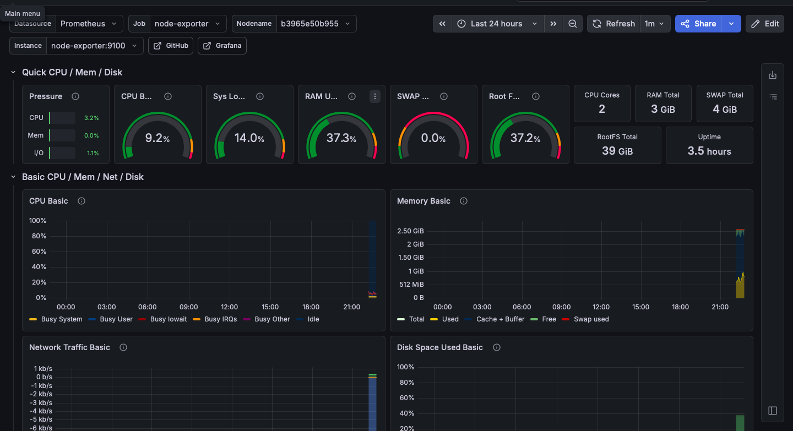

# 🚀 Homelab: Infraestructura Docker, Seguridad Zero-Trust y Observabilidad

Este repositorio contiene la arquitectura como código (IaC) de un entorno de infraestructura (*Homelab*) desplegado sobre **Ubuntu Server** (VirtualBox en modo *Bridge*) y administrado remotamente vía **SSH** desde un entorno anfitrión.

## 🛠️ Stack Tecnológico

* **Infraestructura Base:** Ubuntu Server / Docker Engine & Docker Compose v2
* **Ingress y Reverse Proxy:** Nginx Proxy Manager (NPM)
* **Orquestación y Gestión:** Portainer CE
* **Servicio Web:** Nginx (Imagen ligera Alpine)
* **Observabilidad y Métricas:** Prometheus, Node Exporter y Grafana OSS

---

## 🔒 Arquitectura de Red y Seguridad: Minima Exposición y Defensa en Profundidad

Este laboratorio implementa principios de seguridad defensiva y aislamiento por capas para eliminar superficies de ataque innecesarias:

1. **Punto de Entrada Único:** Únicamente los puertos de **Nginx Proxy Manager (`80`, `443`)** y su interfaz de administración (`81`) están expuestos hacia la red local.
2. **Aislamiento de Servicios Internos:** Los contenedores de **Portainer (`9000`)**, **Nginx Web (`80`)**, **Prometheus (`9090`)**, **Node Exporter (`9100`)** y **Grafana (`3000`)** carecen de puertos mapeados hacia el host, quedando blindados frente a escaneos externos.
3. **Enrutamiento por DNS Interno:** Todo el tráfico fluye a través de una red puente externa aislada (`red-publica-shared`). NPM actúa como intermediario enrutando peticiones mediante resolución de nombres internos de Docker (`portainer.local`, `miweb.local`, `grafana.local`).
4. **Hardening de Privilegios:** El socket de Docker (`/var/run/docker.sock`) se monta en Portainer en modo de **Solo Lectura (`:ro`)** para mitigar riesgos de escalada de privilegios.

---
’’’mermaid
flowchart LR
  A["Equipo anfitrión<br/>hosts + SSH"] -->|"80 / 443"| NPM["Nginx Proxy Manager"]
  subgraph U["Ubuntu Server (Docker)"]
    NPM --> P["Portainer"]
    NPM --> W["Nginx web"]
    NPM --> G["Grafana"]
    G --> PR["Prometheus"]
    PR --> NE["Node Exporter"]
  end
’’’  
## 📊 Capa de Observabilidad en Tiempo Real

El entorno integra una solución completa de monitorización de hardware y rendimiento:
* **Node Exporter:** Recolecta métricas nativas del kernel de Linux (CPU, memoria RAM, almacenamiento y tráfico de red).
* **Prometheus:** Base de datos de series temporales encargada de extraer (*scrape*) los datos cada 15 segundos.
* **Grafana:** Panel de visualización interactivo accesible mediante `http://grafana.local` utilizando el dashboard oficial **Node Exporter Full (ID 1860)**.



---

## ⚙️ Estructura del Proyecto

```text
proyecto-nginx-homelab/
├── .gitignore                 # Exclusión de volúmenes locales y datos sensibles
├── README.md                  # Documentación técnica y bitácora de ingeniería
├── docker-compose.yml         # Definición completa del stack de servicios
├── index.html                 # Aplicación web estática de prueba
├── img/
│   └── grafana-dashboard.png  # Evidencia visual del monitoreo en vivo
└── prometheus/
    └── prometheus.yml         # Configuración de objetivos (targets) de Prometheus
```

---

## 🚀 Guía de Despliegue Rápido

### 1. Resolución de Dominios Locales (Equipo Anfitrión)
Añade las siguientes entradas en el archivo `hosts` de tu sistema operativo anfitrión (`C:\Windows\System32\drivers\etc\hosts` en Windows o `/etc/hosts` en macOS/Linux):

```text
<IP_DE_TU_VM_UBUNTU>   portainer.local
<IP_DE_TU_VM_UBUNTU>   miweb.local
<IP_DE_TU_VM_UBUNTU>   grafana.local
```

### 2. Creación de Red e Inicialización
```bash
# 1. Clonar el repositorio
git clone https://github.com/henrryfloressysadmin/proyecto-nginx-homelab.git
cd proyecto-nginx-homelab

# 2. Crear la red puente compartida externa
docker network create red-publica-shared

# 3. Desplegar toda la infraestructura en segundo plano
docker compose up -d
```

---

## 🛠️ Bitácora de Diagnóstico y Solución de Problemas (Troubleshooting)

Durante el despliegue y aseguramiento del laboratorio se diagnosticaron y resolvieron incidencias reales de infraestructura:

1. **Error 502 Bad Gateway en Portainer (Aislamiento de Interfaces):**
   * **Causa:** Por defecto, el binario de Portainer escuchaba únicamente en `127.0.0.1:9000`, rechazando conexiones provenientes del proxy inverso.
   * **Solución:** Se inyectó el flag `--address 0.0.0.0:9000` en la directiva `command` del servicio para habilitar la escucha en la red interna de Docker.
2. **Bloqueo de Inicialización de Portainer por Timeout:**
   * **Causa:** Expiración de la ventana de seguridad de 5 minutos para configurar la contraseña maestra (mínimo 12 caracteres).
   * **Solución:** Reinicio controlado del servicio (`docker compose restart portainer`) para restablecer el temporizador de inicialización.
3. **Incompatibilidad de Métricas de CPU con cAdvisor en Kernels Modernos (`cgroups v2`):**
   * **Causa:** Falta de telemetría por contenedor debido a diferencias en la lectura de rutas `cgroups v2` en versiones recientes de Ubuntu Server.
   * **Solución:** Se migró la arquitectura de recolección hacia **Prometheus + Node Exporter**, garantizando métricas estables directamente desde el sistema anfitrión.
4. **Fallo de Arranque en Prometheus por Sintaxis YAML:**
   * **Causa:** Indentación inválida en `prometheus.yml` que provocaba un bucle de reinicio (`Restarting`) y error `connection refused` en Grafana.
   * **Solución:** Reescritura limpia de la configuración mediante bloques heredoc (`cat << 'EOF'`) y recreación forzada del contenedor (`--force-recreate`).
